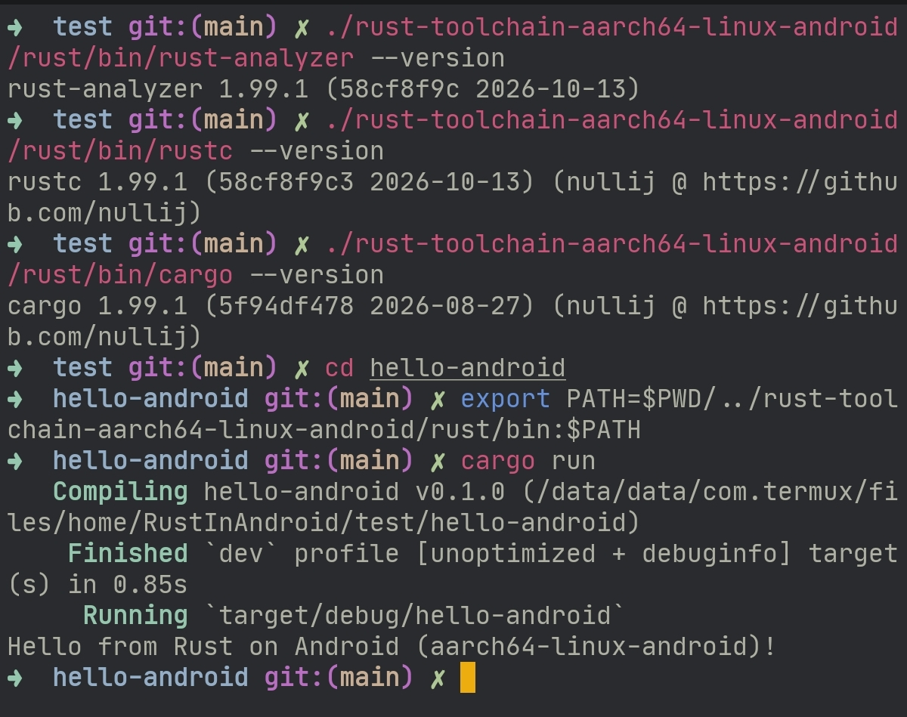
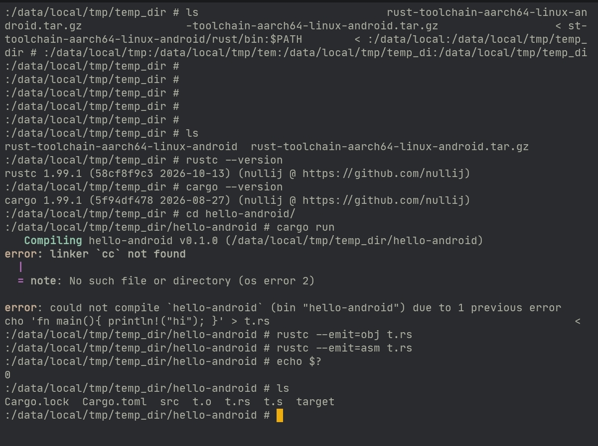

# Rust compiler for Android

**Run `rustc` and `cargo` natively on your Android device. No PC required.**

This project provides an Android-native Rust compiler toolchain for use from
Termux or an Android shell. The current toolchain is based on Rust 1.99.1.
These are command-line programs for Android, not GNU/Linux binaries or an
Android application.

<p align="center">
  
</p>

*`cargo run` compiling and running a Rust program on-device in Termux (aarch64).*

## Download

Download the archive for your device from the
[GitHub Releases page](https://github.com/nullij/android-rust-toolchain/releases).
Choose the archive that matches the Android ABI:

| Android ABI | Rust target | Archive name |
| --- | --- | --- |
| `arm64-v8a` | `aarch64-linux-android` | `rust-toolchain-aarch64-linux-android.tar.gz` |
| `armeabi-v7a` | `armv7-linux-androideabi` | `rust-toolchain-armv7-linux-androideabi.tar.gz` |
| `x86_64` | `x86_64-linux-android` | `rust-toolchain-x86_64-linux-android.tar.gz` |

Most modern Android phones use `arm64-v8a`. To see the ABIs reported by your
device, run `getprop ro.product.cpu.abilist`.

Each archive has a matching `.sha256` file for verifying the download.

## Included tools

Each archive contains:

- `rustc`, `cargo`, `rustdoc` and `rustfmt`;
- `rust-analyzer` and its procedural macro server;
- the Rust standard library for the archive's Android target;
- the Rust source code used by tools such as Rust Analyzer; and
- the `libc++_shared.so` runtime required by the bundled compiler.

The Rust Analyzer procedural macro server is kept at
`rust/libexec/rust-analyzer-proc-macro-srv`. Keep the extracted directory
structure intact so the tools can find their runtime libraries and companion
files.

## Install in Termux

The examples below use the ARM64 archive. Replace its name with the matching
archive for your device. If the archive is in Android's Downloads folder,
enable Termux storage access first with `termux-setup-storage`.

```sh
mkdir -p "$HOME/.local/opt"
cd "$HOME/storage/downloads"
sha256sum -c rust-toolchain-aarch64-linux-android.tar.gz.sha256
tar -xzf rust-toolchain-aarch64-linux-android.tar.gz -C "$HOME/.local/opt"
```

Set the toolchain path in the current shell:

```sh
export RUST_ROOT="$HOME/.local/opt/rust-toolchain-aarch64-linux-android/rust"
export PATH="$RUST_ROOT/bin:$PATH"
rustc --version
cargo --version
```

To keep the path in future Bash sessions, add those two `export` lines to
`$HOME/.bashrc`.

Keep the toolchain in Termux's private home directory or another location
where Android permits executable files. Shared storage such as
`/storage/emulated/0` may be mounted without permission to run binaries.

## Build a Rust project

With the toolchain directory on `PATH`, create and run a small project:

```sh
cargo new hello-android
cd hello-android
cargo run
```

Cargo finds `rustc` through `PATH`, so make sure the toolchain's `bin`
directory is on it before running `cargo`. Calling `cargo` by its full path
without setting `PATH` fails with `could not execute process rustc -vV`.

The archive includes the standard library for its own Android target. Building
for a different Android ABI requires that target's standard library and a
suitable linker. Crates that compile C or C++ code may also need Android NDK
configuration.

## Without Termux (adb shell)

The toolchain also runs in a plain `adb shell`, without Termux. Compiling works
out of the box. Linking requires a clang or lld that runs on Android, plus an
Android sysroot (see [Linking](#linking)).

```sh
adb push rust-toolchain-aarch64-linux-android.tar.gz /data/local/tmp/
adb shell
cd /data/local/tmp
tar -xzf rust-toolchain-aarch64-linux-android.tar.gz
export HOME=/data/local/tmp TMPDIR=/data/local/tmp
export RUST_ROOT=/data/local/tmp/rust-toolchain-aarch64-linux-android/rust
export PATH=$RUST_ROOT/bin:$PATH
rustc --version
```

If a tool reports that it cannot find `libc++_shared.so`, add the toolchain's
`lib` directory to the library path:

```sh
export LD_LIBRARY_PATH=$RUST_ROOT/lib:$LD_LIBRARY_PATH
```

Compile a file to an object file or assembly, no linker needed:

```sh
echo 'fn main(){ println!("hi"); }' > t.rs
rustc --emit=obj t.rs
rustc --emit=asm t.rs
```



Use `/data/local/tmp` or another location where the `shell` user may execute
files.

## Linking

Producing an executable needs a linker (`cc`) and the Android C runtime files.
A bare Android shell has neither, so `cargo run` fails with
`linker 'cc' not found`.

- **Termux:** run `pkg install clang`.
- **adb shell:** provide a clang or lld that runs on Android (the Android NDK's
  prebuilt clang runs on the host computer, not on the device) and an Android
  sysroot containing `crt*.o`, `libc.so`, `libm.so` and `libdl.so`.

Then point Cargo at the linker in `.cargo/config.toml`:

```toml
[target.aarch64-linux-android]
linker = "/path/to/your/clang"
```

## Rust Analyzer

Point your editor to the extracted `rust-analyzer` executable, or make sure
the toolchain's `bin` directory is on the editor's `PATH`. Keep the complete
toolchain directory available: Rust Analyzer uses the bundled Rust sources,
and procedural macro support uses the server in `rust/libexec`.

## Notes

This is a custom Rust toolchain built to run on Android. Some packages rely on
host features or native libraries that are not available in every Android
environment. Android may also restrict executable files in shared storage or
inside application sandboxes. Running the compiler from Termux or a suitable
Android shell is the intended use.
